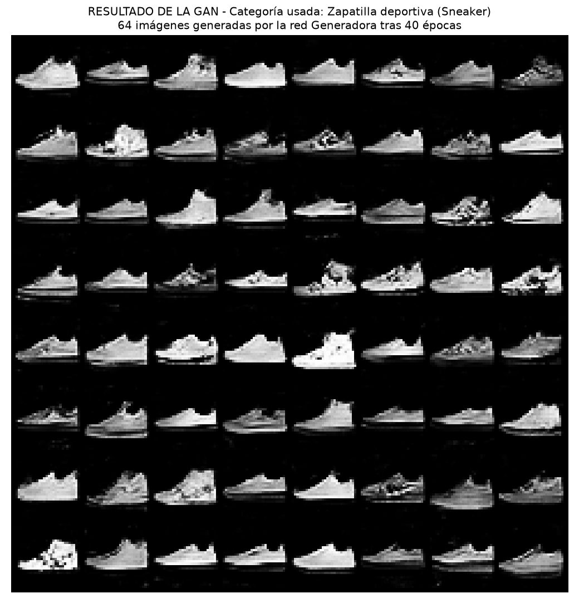
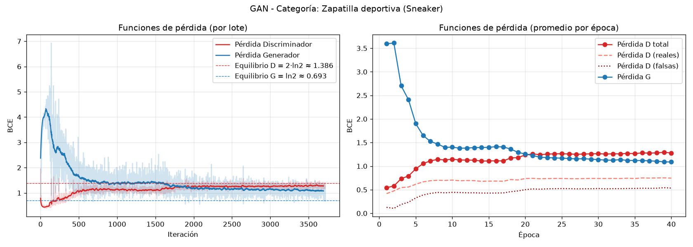
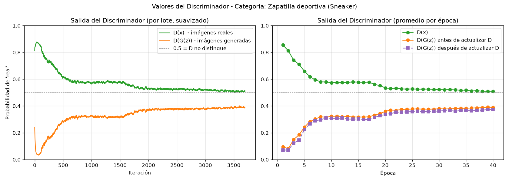
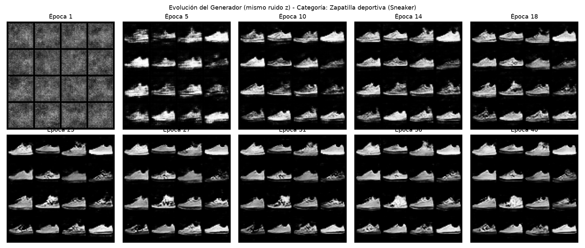
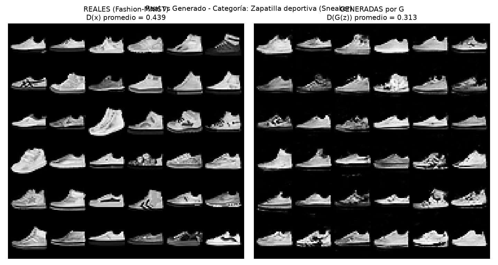
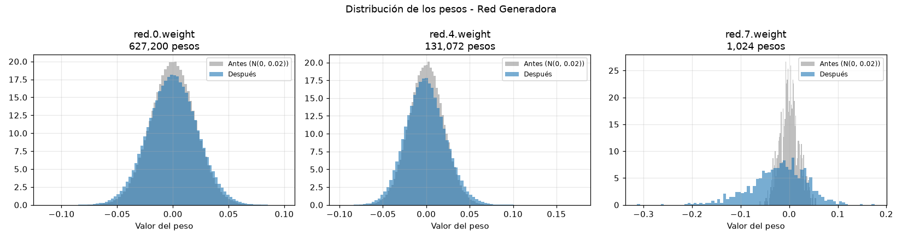
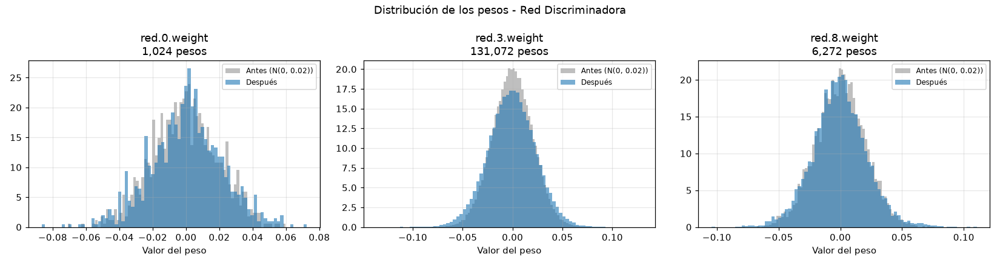

# GAN-NOV  Red Generativa Adversaria con Fashion-MNIST

Proyecto de la materia IA Generativa. La idea era armar una GAN desde cero en PyTorch y poder ver bien que pasa por dentro: los parametros de la red generadora y de la discriminadora, las funciones de perdida, los valores que van tomando las dos redes mientras entrenan y el resultado final.

La GAN se entrena con una sola categoria de Fashion-MNIST, por defecto use la **categoria 7: Zapatilla deportiva (Sneaker)**, que son 6000 imagenes de 28x28 en escala de grises.



## Como funciona una GAN (rapido)

Son dos redes que compiten entre si

- El **Generador (G)** recibe un vector de ruido aleatorio `z` de 100 numeros y a partir de eso dibuja una imagen falsa.
- El **Discriminador (D)** recibe una imagen y devuelve un numero entre 0 y 1 que es la probabilidad de que la imagen sea real.

D intenta no dejarse engañar y G intenta engañar a D. Al principio D gana facil porque G solo saca ruido, pero poco a poco G va aprendiendo la forma de la zapatilla hasta que a D le cuesta distinguir cual es real y cual no. En teoria el punto ideal es cuando D responde 0.5 para todo.

## Como correrlo

Se necesita [uv](https://docs.astral.sh/uv/) y Python 3.12

```bash
git clone https://github.com/NicVar1/GAN-NOV.git
cd GAN-NOV
uv sync
```

Comandos:

```bash
uv run gan-entrenar                  # entrena 40 epocas con la categoria 7
uv run gan-entrenar --categoria 1    # otra categoria (1 = pantalon, 8 = bolso, etc)
uv run gan-entrenar --epocas 20
uv run gan-generar                   # genera imagenes nuevas con el generador ya entrenado
uv run gan-web                       # abre la pagina web interactiva
```

La primera vez descarga el dataset solo (queda en la carpeta `datos/`). En CPU se demora mas o menos 4 minutos, son unos 6 segundos por epoca.

Las categorias son: 0 camiseta, 1 pantalon, 2 sueter, 3 vestido, 4 abrigo, 5 sandalia, 6 camisa, 7 zapatilla, 8 bolso, 9 botin.

## Estructura del codigo

```
src/gan_fashion_mnist/
    configuracion.py   -> todos los hiperparametros
    datos.py           -> carga Fashion-MNIST y filtra la categoria
    redes.py           -> AQUI SE CREAN LAS DOS REDES
    perdidas.py        -> funciones de perdida
    entrenamiento.py   -> el ciclo de entrenamiento
    inspeccion.py      -> imprime arquitectura y valores de los pesos
    visualizacion.py   -> graficas
    generar.py         -> usar el generador ya entrenado
    web.py             -> exporta los datos para la pagina
    __init__.py        -> main, corre todo en orden
frontend/              -> pagina web (index.html)
salidas/categoria_7/   -> resultados de mi entrenamiento
```

Todo el codigo esta comentado. Donde se crea cada red esta marcado con un comentario `AQUÍ SE CREA LA RED NEURONAL ...` para que sea facil encontrarlo:

- **Red generadora:** la clase `Generador` en `redes.py` y se crea con la funcion `crear_generador()`
- **Red discriminadora:** la clase `Discriminador` en `redes.py` y se crea con `crear_discriminador()`
- En `__init__.py` (la funcion `main`) es donde se llaman las dos funciones.

## Red Generadora

Recibe el ruido `z` (100 valores) y lo va agrandando: 7x7 -> 14x14 -> 28x28.

| # | Capa | Que hace | Salida | Parametros |
|---|---|---|---|---|
| 0 | Linear 100 -> 6272 | proyecta el ruido | 6272 | 627.200 |
| 1 | BatchNorm1d | normaliza | 6272 | 12.544 |
| 2 | ReLU | | 6272 | 0 |
| 3 | Unflatten | lo vuelve 128 mapas de 7x7 | 128x7x7 | 0 |
| 4 | ConvTranspose2d 128->64 | duplica el tamaño | 64x14x14 | 131.072 |
| 5 | BatchNorm2d | | 64x14x14 | 128 |
| 6 | ReLU | | 64x14x14 | 0 |
| 7 | ConvTranspose2d 64->1 | duplica otra vez | 1x28x28 | 1.025 |
| 8 | Tanh | deja los pixeles entre -1 y 1 | 1x28x28 | 0 |

**Total: 771.969 parametros**

Algunas cosas a tener en cuenta:
- `dim_latente = 100` es el tamaño del ruido, cada z distinto da una zapatilla distinta
- la capa Linear es la que tiene casi todos los parametros (100 x 6272)
- la ConvTranspose (kernel 4, stride 2, padding 1) es como una convolucion al reves, en vez de reducir la imagen la agranda
- se usa Tanh al final porque las imagenes reales se normalizan entre -1 y 1, asi quedan en la misma escala

## Red Discriminadora

Es basicamente un clasificador binario con convoluciones, la imagen se va reduciendo 28 -> 14 -> 7 y al final sale un solo numero.

| # | Capa | Que hace | Salida | Parametros |
|---|---|---|---|---|
| 0 | Conv2d 1->64 | detecta bordes | 64x14x14 | 1.088 |
| 1 | LeakyReLU (0.2) | | 64x14x14 | 0 |
| 2 | Dropout (0.3) | | 64x14x14 | 0 |
| 3 | Conv2d 64->128 | detecta partes (suela, cordones..) | 128x7x7 | 131.072 |
| 4 | BatchNorm2d | | 128x7x7 | 256 |
| 5 | LeakyReLU (0.2) | | 128x7x7 | 0 |
| 6 | Dropout (0.3) | | 128x7x7 | 0 |
| 7 | Flatten | | 6272 | 0 |
| 8 | Linear 6272 -> 1 | puntaje final | 1 | 6.273 |
| 9 | Sigmoid | lo vuelve probabilidad | 1 | 0 |

**Total: 138.689 parametros**

- se usa LeakyReLU en vez de ReLU para que los negativos no se pierdan del todo y el generador siga recibiendo gradiente
- el Dropout es para que D no se vuelva demasiado bueno muy rapido, si D gana muy facil G deja de aprender

## Hiperparametros

| Parametro | Valor |
|---|---|
| epocas | 40 |
| tamaño de lote | 64 |
| learning rate (G y D) | 0.0002 |
| optimizador | Adam, beta1 = 0.5 , beta2 = 0.999 |
| etiqueta real | 0.9 |
| etiqueta falsa | 0 |
| inicializacion de pesos | normal(0, 0.02) |
| semilla | 42 |

Casi todos son los valores recomendados en el paper de DCGAN. Lo de poner la etiqueta real en 0.9 en vez de 1 se llama *label smoothing*, sirve para que D no se confie tanto.

## Funciones de perdida

Las dos redes usan entropia cruzada binaria (BCE):

```
BCE(p, y) = -[ y*log(p) + (1-y)*log(1-p) ]
```

**Discriminador:**
```
L_D = BCE(D(x), 0.9) + BCE(D(G(z)), 0)
```
o sea D quiere que D(x) sea alto (reconocer las reales) y que D(G(z)) sea bajo (detectar las falsas).

**Generador:**
```
L_G = BCE(D(G(z)), 1) = -log(D(G(z)))
```
G quiere que D diga que sus imagenes son reales. Aqui se usa la version "no saturante", en vez de minimizar log(1 - D(G(z))) que es la formula original, porque al inicio esa casi no da gradiente.

Valores de referencia: si D no distingue nada (todo 0.5) entonces L_D = 1.386 y L_G = 0.693

Esto esta en `perdidas.py`.

## Entrenamiento

En cada lote se hacen 2 pasos (`entrenamiento.py`):

1. **Entrenar D:** se le pasan 64 imagenes reales y 64 falsas, se calcula L_D y se actualizan solo los pesos de D. Las falsas se pasan con `.detach()` para que el gradiente no llegue a G
2. **Entrenar G:** D vuelve a evaluar las falsas, se calcula L_G y se actualizan solo los pesos de G (el gradiente pasa por D pero D no cambia)

## Resultados



| Epoca | Perdida D | Perdida G | D(x) | D(G(z)) |
|---|---|---|---|---|
| 1 | 0.543 | 3.595 | 0.855 | 0.095 |
| 5 | 0.942 | 1.900 | 0.659 | 0.242 |
| 10 | 1.148 | 1.403 | 0.574 | 0.324 |
| 20 | 1.237 | 1.256 | 0.535 | 0.360 |
| 30 | 1.264 | 1.138 | 0.523 | 0.380 |
| 40 | 1.279 | 1.088 | 0.511 | 0.390 |

Lo que se ve:
- en las primeras epocas D gana facil, D(G(z)) es 0.09 y la perdida de G esta muy alta
- despues G empieza a sacar la forma de la zapatilla y las perdidas se van acercando
- al final las dos quedan cerca del equilibrio (1.28 y 1.09) y D(x) y D(G(z)) se acercan a 0.5, que es lo que se busca. No hubo colapso de modo, las zapatillas generadas salen variadas



Evolucion del generador con el mismo ruido en distintas epocas:



Real vs generado:



### Valores de los pesos

Al correr el programa se imprimen en consola los valores de cada tensor de pesos de las dos redes (media, desviacion, min, max y los primeros valores) antes y despues de entrenar. Todo queda guardado en `salidas/categoria_7/resumen.json` y la salida completa de la consola esta en `salidas/registro_consola.txt`.




La capa que mas cambia es la ultima del generador, que es la que decide el brillo de cada pixel.

## Pagina web

Hice tambien una pagina para explicar todo de forma mas visual, se abre con `uv run gan-web` o dando doble clic a `frontend/index.html`.

Lo interesante es que las dos redes corren en el navegador con los pesos entrenados (en `frontend/gan.js` esta la misma red pero en javascript) entonces se puede:

- generar zapatillas nuevas y ver las activaciones de cada capa del generador y del discriminador
- mostrarle a D imagenes reales o falsas y ver el puntaje que les da
- ver cada capa con sus parametros
- mover unos sliders para entender las funciones de perdida
- reproducir el entrenamiento epoca por epoca
- ver los pesos antes y despues

Si se entrena otra categoria hay que correr `uv run gan-web --categoria N` para actualizar la pagina.

## Archivos de salida

En `salidas/categoria_7/` quedan:
- las graficas (01 a 09) y `evolucion.gif`
- `historial_epocas.csv` con los valores de cada epoca
- `resumen.json` con arquitectura, pesos y metricas
- `generador.pth` y `discriminador.pth` (los modelos entrenados)

## Nota

Se instala PyTorch para CPU. Si se quiere usar GPU NVIDIA hay que cambiar en `pyproject.toml` la url `https://download.pytorch.org/whl/cpu` por `https://download.pytorch.org/whl/cu128` y volver a hacer `uv sync`.

---
Nicolas Otero Vargas
